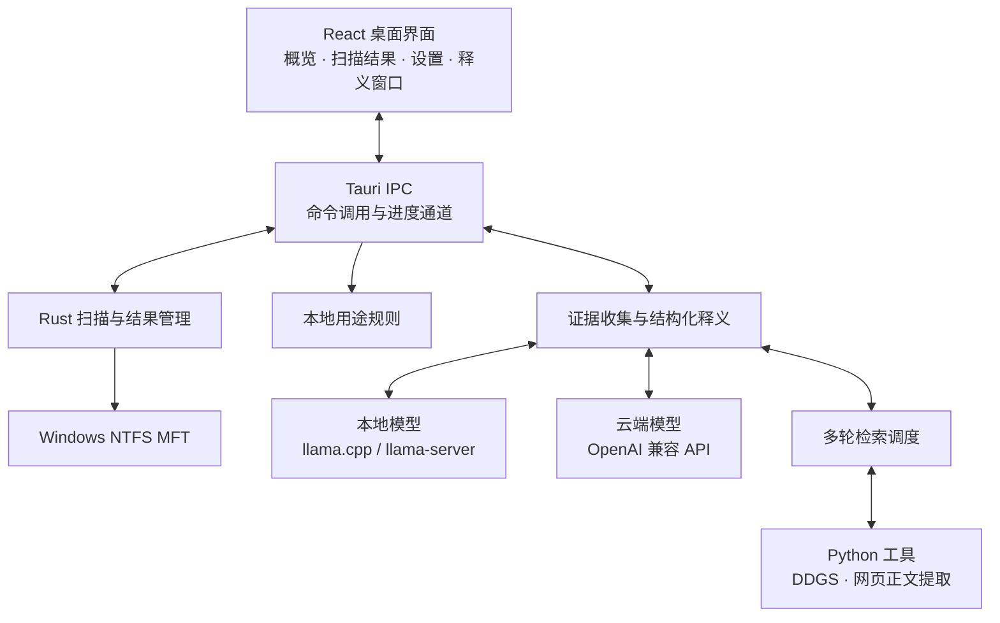

# C盘守护者

C盘守护者是一款面向 Windows 的桌面文件分析工具。它将大文件扫描、本地用途分类和 AI 文件释义放在同一个界面中，帮助你了解磁盘空间被什么占用、文件可能属于哪个应用，以及处理文件会带来什么影响。

应用使用 **Tauri 2 + React + Rust** 构建，支持本地 GGUF 模型和 OpenAI 兼容的云端模型接口。扫描和规则分类在本机完成；需要进一步确认文件用途时，可以启用联网检索，结合网页来源生成带依据的解释。

本文介绍 `main` 分支的功能与部署方式。

## 项目功能

### 磁盘概览与大文件扫描

- 展示磁盘容量、已用空间和剩余空间。
- 按最小文件大小筛选结果，查看文件名、完整路径、逻辑大小和用途分类。
- 使用 NTFS 主文件表（MFT）双读取 worker 扫描整盘，两个线程使用独立卷句柄读取记录，并核验候选文件大小。
- 支持扫描进度、取消、诊断详情和扫描报告复制。
- 后端保留全部命中结果，前端每页显示 100 条；分类筛选、全选和报告覆盖相应分类的全部结果。
- 分批传输时核对序号、数量与路径/大小摘要，发现传输缺失时从后端分页恢复。

当前扫描入口要求 **Windows、管理员权限、NTFS 文件系统和盘符根目录**，例如 `C:\`。显示的逻辑大小不等于可释放空间；硬链接、稀疏文件和扫描期间发生的文件变化都会影响两者关系。

### 本地用途分类

程序使用本地规则匹配路径、文件名和扩展名，为文件显示缓存、日志、下载内容等用途标签，并区分文档、图片、压缩包、视频、安装包等类型。

分类不依赖模型，不需要联网。没有匹配到规则的文件仍然可以请求 AI 释义。**用途标签只表示规则命中，不表示文件可以安全删除，也不表示程序已检查文件是否正在使用。**

### 带依据的 AI 文件释义

点击扫描结果中的文件，会打开释义窗口并收集本机线索，包括文件属性、目录上下文、相关模型配置和可执行文件的产品信息。随后可以选择使用本机线索生成解释，或启用联网分析。

解释主要回答以下问题：

- **它有什么用**：文件的可能归属及用途。
- **处理后会怎样**：删除或清理可能造成的影响。
- **应该如何处理**：保留、使用软件自带入口清理，或进一步确认。
- **能否恢复**：恢复所需条件和仍然未知的信息。

主界面提供简洁结论，详情保留来源链接、引用、恢复条件和不确定性。可以在当前文件的释义窗口继续提问。本地模型使用 GBNF 约束结构化输出，后端校验字段和引用；这能约束回答格式，但不能保证模型的事实判断正确。

### 多轮联网检索

联网分析通过 **DDGS** 搜索网页，不需要搜索服务 API Key。模型根据缺少的依据安排查询、正文阅读、来源关联核对和补充搜索，而不是只对文件名进行一次搜索。

- 展示实际查询、工具执行结果、来源链接和模型整理的依据摘要。
- 支持中文查询，保留必要的英文软件名与组件名。
- 核对来源是否属于目标软件，并排除明显不相关的同名文件资料。
- 最多执行 8 次搜索、正文读取或页内查找；搜索和正文工具单次限时 30 秒，模型推理耗时另计。
- 区分搜索摘要与已读取的网页正文，保留搜索失败和未解决的问题。

搜索引擎限流、验证码、无结果或网页读取失败时，检索可能无法完成。无法找到依据不等于文件可以删除。

### 本地模型与云端 API

| 模式 | 运行方式 | 需要准备 |
| --- | --- | --- |
| 内置本地模型 | Rust 通过 llama.cpp 加载 Qwen3.5-0.8B GGUF | 对应 GGUF 文件 |
| 外部本地模型 | 应用管理本机 llama-server 进程，可加载 Qwen3.5-4B 等兼容 GGUF | 模型清单、模型文件、兼容的 llama-server |
| 云端模型 | 调用 OpenRouter / OpenAI 兼容接口 | API Key、Base URL、模型 ID |

本地模型在设置中选择后需点击“加载并使用所选模型”，显示“已就绪”后才能用于释义。扫描本身不需要先加载模型。

### 文件操作

可以打开文件所在位置，也可以勾选文件并确认移入回收站。模型解释不会自动执行删除；文件操作由用户显式触发。重要文件应先备份，回收站能力仍受 Windows、文件大小和存储位置限制。

## 项目架构

应用由桌面前端、Rust 应用层、扫描与证据模块，以及可选的模型/搜索运行时组成。



### 各层职责

| 层级 | 技术与模块 | 职责 |
| --- | --- | --- |
| 界面层 | React 19、TypeScript、Vite、Framer Motion、Recharts | 页面状态、扫描列表、设置、释义及检索记录展示 |
| 桌面桥接层 | Tauri 2、前端 `api.ts`、Rust commands | 对外提供扫描、模型、释义、文件操作命令，传递进度与结果 |
| 扫描层 | Rust、Windows API、MFT 解析 | 卷读取、路径重建、大小筛选、取消、报告与完整性信息 |
| 本地证据层 | 用途规则、文件元数据、产品版本信息 | 收集文件上下文，形成供模型分析的证据包 |
| 释义层 | 结构化协议、GBNF、引用校验 | 组织提示、调用模型、解析回答并保留未知项 |
| 检索层 | Rust 调度、Python DDGS、lxml | 执行查询、读取公开网页、整理可引用资料 |
| 模型层 | llama.cpp、llama-server、HTTP API | 本地或云端推理 |

### 数据如何流动

**扫描流程**：用户选择盘符和大小阈值 → Rust 扫描 MFT → 分批发送结果 → 前端核对与分页展示 → 本地规则补充用途分类。

**释义流程**：用户点击文件 → 收集并展示本机证据 → 选择本机解释或联网分析 → 模型结合证据生成结构化回答 → 展示结论、引用和待确认事项。

**联网流程**：模型提出查询 → 程序校验参数并调用搜索工具 → 阅读或排除来源 → 根据缺口继续检索 → 将原始证据交给最终释义步骤。模型生成的过程摘要不会替代原始网页证据。

### 主要目录

```text
C_manager/
├─ frontend/
│  ├─ src/
│  │  ├─ App.tsx                  # 应用状态与页面调度
│  │  ├─ api.ts                   # Tauri 命令与通道封装
│  │  ├─ types.ts                 # 前后端交互类型
│  │  └─ components/              # 概览、扫描列表、设置、释义组件
│  └─ tests/                      # 前端回归检查
├─ src-tauri/
│  ├─ src/
│  │  ├─ commands/                # 扫描、分类、释义、模型与文件操作
│  │  │  ├─ search_agent.rs       # 多轮检索调度
│  │  │  ├─ ddgs_search.py        # 搜索工具
│  │  │  └─ read_pages.py         # 网页读取与正文提取
│  │  ├─ scanner/                # MFT 扫描引擎与报告结构
│  │  ├─ safety/                 # 本地路径规则与用途资料
│  │  └─ bin/export_scan.rs      # 扫描结果导出命令
│  ├─ resources/                  # 本地模型与运行资源
│  └─ tauri.conf.json             # 窗口、构建和打包配置
├─ docs/                          # 模块设计与使用边界
├─ AGENTS.md                      # 开发分支与工作目录约定
└─ package.json                   # 桌面开发与构建入口
```

## 快速开始

以下命令在 **Windows PowerShell** 中执行。除另有说明外，工作目录均为仓库根目录。

### 1. 准备环境

- Windows 10/11，使用 NTFS 的本地磁盘。
- Node.js 与 npm，版本需满足仓库中 Vite 的要求。
- Rust stable，使用 Windows MSVC 工具链。
- Visual Studio C++ Build Tools、Windows SDK 和 WebView2 Runtime；原生模型依赖还需要可用的 C/C++ 构建环境。
- 启用联网搜索时，另需 Python 环境和访问搜索引擎的网络连接。
- 使用本地模型时，需准备 GGUF 权重及足够的内存；外部模型还需匹配的 llama-server。

Tauri 平台依赖的安装方式见 [Tauri Windows 环境准备](https://v2.tauri.app/start/prerequisites/)。模型权重和外部引擎不包含在 Git 仓库中。

### 2. 获取源码和安装依赖

```powershell
git clone https://github.com/szaaaaaa/C_manager.git
cd C_manager
npm ci
npm --prefix frontend ci
```

### 3. 准备默认模型资源

将兼容的 Qwen3.5-0.8B GGUF 文件放到：

```text
src-tauri/resources/qwen3.5-0.8b-q4_k_m.gguf
```

这是当前 `main` 打包配置声明的资源，构建前需要存在；即使计划在界面中使用云端模型，也要满足这项构建资源要求。不要用空文件代替模型。

### 4. 启动桌面应用

```powershell
npm run dev
```

该命令会启动前端开发服务和 Tauri 桌面窗口。只运行 `npm run frontend:dev` 会启动浏览器页面，无法代替包含文件扫描能力的桌面程序。

首次扫描时按应用提示提升管理员权限，或从管理员 PowerShell 启动。然后：

1. 在概览中选择 NTFS 盘符根目录和最小文件大小，开始扫描。
2. 在结果页按类型筛选，查看路径、大小与用途分类。
3. 打开设置，选择本地模型并加载，或配置云端 API。
4. 点击文件查看本机线索，再选择本机解释或联网分析。

需要联网释义或外部 4B 模型时，继续完成下面的配置。

## 配置模型与联网搜索

### 云端 API

在设置中选择“云端 API”，填写 API Key、Base URL 和模型 ID，再保存配置。Base URL 应填写 API 根地址，不包含 `/chat/completions`。

也可在启动应用的 PowerShell 中设置环境变量，并在界面勾选“使用环境变量”：

```powershell
$env:OPENROUTER_API_KEY = '替换为你的密钥'
# 使用 OpenAI 兼容服务时也可设置 OPENAI_API_KEY
npm run dev
```

应用识别 `OPENROUTER_API_KEY` 和 `OPENAI_API_KEY`。密钥不要写入 README、模型清单或提交到仓库。

### 外部本地模型

准备好模型文件与完整的 llama-server 运行目录，在 `src-tauri/resources/local-models.json` 创建模型清单。下面以 Qwen3.5-4B 原版为例，所有路径都应替换为本机真实绝对路径：

```json
[
  {
    "id": "qwen35-4b",
    "name": "Qwen3.5-4B · 原版",
    "path": "D:/models/Qwen3.5-4B-Q4_K_M.gguf",
    "server": "D:/tools/llama/llama-server.exe"
  }
]
```

模型 ID 必须唯一，不能使用内置模型保留值 `builtin`。不填写 `adapter` 时使用原版模型；引擎所需 DLL 应与其一起部署。应用负责启动和关闭模型服务，无需另开终端手动启动它。

将该 JSON 加入下文的资源打包清单，重启应用后即可在设置中选择并加载。

### 搜索运行时

从仓库根目录创建独立 Python 环境：

```powershell
python -m venv src-tauri/target/search-runtime
./src-tauri/target/search-runtime/Scripts/python.exe -m pip install ddgs==9.16.0 lxml
```

创建 `src-tauri/resources/search-tools.json`，将 `python` 设置为上一步生成的解释器绝对路径。例如仓库位于 `D:/C_manager`：

```json
{
  "python": "D:/C_manager/src-tauri/target/search-runtime/Scripts/python.exe"
}
```

搜索使用这里指定的 Python，不会自动使用系统 Python，也不要求安装训练依赖。启用云端模型不等于已配置搜索运行时；两者需要分别准备。

### 让配置随程序部署

当前主分支的 `src-tauri/tauri.conf.json` 只声明了默认模型资源。准备好上述两个 JSON 后，将其中的 `bundle.resources` 改为：

```json
"bundle": {
  "resources": [
    "resources/qwen3.5-0.8b-q4_k_m.gguf",
    "resources/local-models.json",
    "resources/search-tools.json"
  ]
}
```

只启用搜索或只启用外部模型时，仅添加实际创建的文件。随后重新启动开发程序或重新构建，Tauri 会把这些配置部署到运行资源目录。

JSON 中引用的 Python、模型和 llama-server 使用绝对路径，**不会因为打包了 JSON 就自动打包对应运行环境**。换机器或移动资源后需更新配置并部署这些依赖。直接运行 Windows 构建产物时，配置通常位于 EXE 旁的 `resources/` 目录。

## 构建与常用命令

### 构建 Windows 程序

完成依赖安装、默认模型准备及所需资源配置后，在仓库根目录执行：

```powershell
npm run build
```

该命令先编译前端，再构建 Rust 桌面程序。主程序路径为：

```text
src-tauri/target/release/c-manager.exe
```

启用安装包构建时，安装包输出位于 `src-tauri/target/release/bundle/`。运行时请保留资源目录，并确保配置引用的模型、引擎和 Python 环境仍然存在；不要仅复制 EXE。

### 开发检查

```powershell
npm --prefix frontend test
npm --prefix frontend run lint
npm --prefix frontend run build
cargo test --manifest-path src-tauri/Cargo.toml --lib
```

需要真实模型、外部网络或特定 Windows 环境的测试不会默认全部执行。

### 导出扫描结果

在管理员 PowerShell 中执行以下命令，可将大于等于 100 MiB 的文件导出为 JSON：

```powershell
cargo run --manifest-path src-tauri/Cargo.toml --bin export_scan -- 'C:\' 100 mft_dual > scan-results.json
```

标准输出为文件数组，标准错误为扫描摘要。退出码 `0` 表示完成，`2` 表示部分完成或取消，`1` 表示参数或启动等错误。调用方应检查退出码与摘要，不要把部分结果当作完整清单。

## 数据与使用边界

- **扫描与分类**：在本机处理路径、大小及规则匹配，不依赖云端模型。
- **本地推理**：通过本机模型处理证据。程序还会读取少量相关配置和产品元数据，不等同于完全不读取文件内容。
- **联网搜索**：查询可能包含文件名、软件名和组件名；程序限制完整路径、用户名和私有目录外发。
- **云端推理**：会向配置的模型服务发送完整路径、本机线索和问题，请根据自己的数据要求选择。
- **网页读取**：仅访问通过公网地址检查的 HTTP(S) 页面，不运行网页脚本；不跟随重定向，限制响应大小。
- **清理建议**：资料与模型都可能出错，文件归属、是否正在使用、备份状态仍可能未知。不要仅凭用途标签或 AI 结论删除重要数据。

## 常见问题

| 问题 | 排查方式 |
| --- | --- |
| 无法开始扫描 | 确认已提升管理员权限，目标是 NTFS 盘符根目录，而非普通文件夹或网络路径。 |
| 构建提示模型资源不存在 | 检查默认 GGUF 的路径和文件名是否与 `tauri.conf.json` 一致。 |
| 本地模型未加载 | 在设置中选择模型并点击加载，核对 GGUF、llama-server 和所需 DLL，查看加载错误。 |
| 外部模型没有出现在列表 | 检查 `local-models.json` 是否已加入资源清单，以及清单中的路径是否存在。 |
| 无法读取搜索配置 | 检查运行资源目录中的 `resources/search-tools.json`，并确认已重新启动或构建程序。 |
| 无法启动搜索工具 | 确认配置中的 Python 路径存在，且该环境安装了 DDGS 和 lxml。 |
| 搜索返回空结果或超时 | 检查网络与搜索服务状态，调整查询；限流、验证码或无匹配网页都可能导致失败。 |
| 只打开了浏览器页面 | 使用根目录的 `npm run dev` 启动 Tauri，而非只启动 Vite。 |
| 程序换目录或换机器后不可用 | 一并部署运行资源，并更新 JSON 内的绝对路径。 |

开发前请阅读 [AGENTS.md](AGENTS.md)，遵循扫描、文件释义和其他功能的分支及独立工作目录约定。
